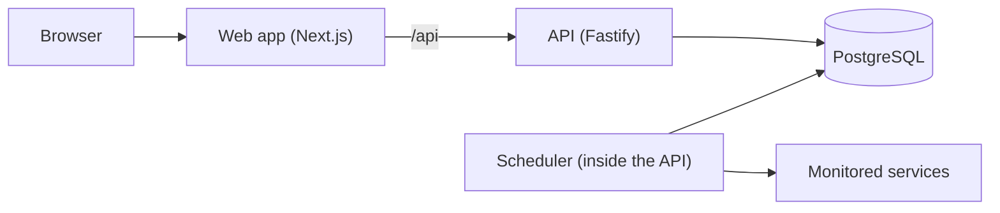

# Pulseboard

Uptime monitoring with team dashboards and public status pages. Add a URL, Pulseboard checks it on
a schedule, and your team and your users can see when it fails.

> **Status: phase 1 of 6.** This README describes only what is built. See [Roadmap](#roadmap).

## Features

- Email and password sign-up, plus optional OpenID Connect single sign-on
- Teams with owner, admin and member roles, and single-use invite links
- HTTP checks every 1 to 60 minutes, with status, latency and recent history
- A public status page per team that never exposes URLs or error details
- OpenAPI documentation at `/api/docs`

## Architecture



| Part | Technology |
| --- | --- |
| Web | Next.js, React, TypeScript, Tailwind CSS |
| API | Node.js, Fastify, Zod, OpenAPI |
| Data | PostgreSQL with row-level security, plain SQL migrations |
| Tests | Vitest, Testcontainers, Playwright |
| Delivery | Docker Compose, GitHub Actions, Caddy |

## Security design

- **Tenant isolation** is enforced by PostgreSQL row-level security as well as by the API
  ([decision 2](docs/decisions/0002-row-level-security.md)).
- **SSRF protection:** monitored URLs must resolve only to public addresses, connections are pinned
  to the checked address and redirects are not followed
  ([decision 3](docs/decisions/0003-ssrf-protection.md)).
- **Accounts:** scrypt password hashes, server-side sessions stored as hashes, `HttpOnly`
  `SameSite=Lax` cookies, origin checks and rate limits
  ([decision 4](docs/decisions/0004-authentication.md)).

## Run it

You need [Docker](https://www.docker.com/products/docker-desktop/). For development you also need
Node.js 22.12 or later.

### Everything in Docker

```sh
docker compose up --build
```

Open http://localhost:3000.

### Development with live reload

```sh
npm ci
cp .env.example .env      # PowerShell: Copy-Item .env.example .env
npm run db:up             # PostgreSQL on port 5433
npm run db:migrate
npm run dev               # web on :3000, API on :4000
```

To see a failed check, add `https://does-not-exist.invalid/` as a service.

## Test

```sh
npm run lint
npm run typecheck
npm test                  # starts a temporary PostgreSQL with Testcontainers (needs Docker)
```

End-to-end tests need the database from `npm run db:up`, a `.env` file and a build. Stop
`npm run dev` first.

```sh
npm run build
npm run db:migrate
npx playwright install chromium
npm run test:e2e
```

## Project layout

```
apps/api        API, scheduler, SQL migrations and tests
apps/web        Next.js web app
e2e             Browser tests
deploy          Reverse proxy configuration
docs            Deployment guide and decision records
```

## Known limitations

- Email addresses are not verified and there is no password reset yet.
- Sign-up reveals whether an email address already has an account.
- A single failed check marks a service as down. Alerts and incidents arrive in phase 2.
- Checks run inside the API process. Phase 2 moves them to separate workers.
- Open sign-up lets anyone make the server send requests to public URLs, within per-user limits.

## Roadmap

- [x] **1. Working product:** accounts, teams, checks, dashboard, status page
- [ ] **2. Event pipeline:** Go workers, Kafka, Redis, live updates, alerts
- [ ] **3. Cloud delivery:** Terraform, Kubernetes, Argo CD
- [ ] **4. Reliability and security:** tracing, metrics, load tests, failure drills
- [ ] **5. AI assistant:** runbook search and incident summaries
- [ ] **6. Billing and presentation**
