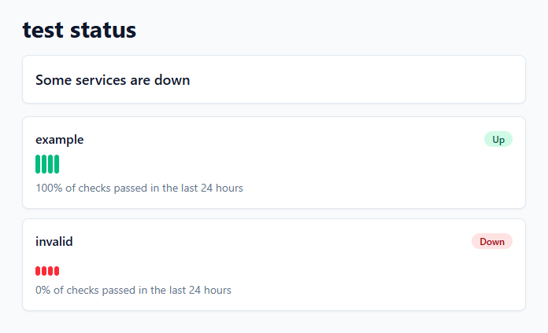
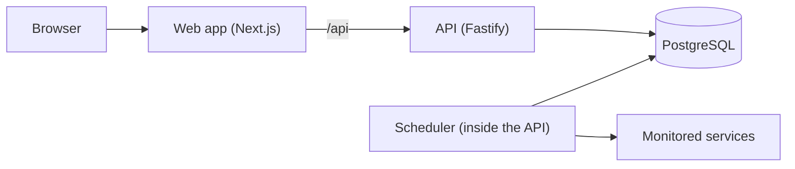

# Pulseboard

[](https://github.com/T-S-T-T/Pulseboard/actions/workflows/ci.yml)

Uptime monitoring with team dashboards and public status pages. Add a URL, Pulseboard checks it on
a schedule, and your team and your users can see when it fails.

> **Status: phase 1 of 6 complete, phase 2 in progress.** Features below are built; planned work is in the [Roadmap](#roadmap).
> The project runs locally with Docker. There is no hosted demo.

## Screenshots

**Team dashboard:** current state, recent history and the reason for a failure.


**Public status page:** service names and uptime only.



## Features

- Email and password sign-up, plus optional OpenID Connect single sign-on
- Teams with owner, admin and member roles, and single-use invite links
- HTTP checks every 1 to 60 minutes, with status, latency and recent history
- Incidents that open after two failed checks in a row and resolve on recovery
- Checks that survive a crash: unfinished ones are retried and each result is recorded once
  ([decision 5](docs/decisions/0005-check-jobs.md))
- A public status page per team that never exposes URLs or error details
- OpenAPI documentation at `/api/docs`

## Architecture



| Part | Technology |
| --- | --- |
| Web | Next.js, React, TypeScript, Tailwind CSS |
| API | Node.js, Fastify, Zod, OpenAPI |
| Data | PostgreSQL with row-level security, plain SQL migrations |
| Workers (in progress) | Go URL checker, not yet connected to the app |
| Tests | Vitest, Testcontainers, Playwright, `go test` |
| Running and CI | Docker Compose, GitHub Actions |

## Security design

- **Tenant isolation** is enforced by PostgreSQL row-level security as well as by the API
  ([decision 2](docs/decisions/0002-row-level-security.md)).
- **SSRF protection:** monitored URLs must resolve only to public addresses, connections are pinned
  to the checked address and redirects are not followed
  ([decision 3](docs/decisions/0003-ssrf-protection.md)).
  The TypeScript and Go versions run the same [test cases](testdata/ssrf-cases.json).
- **Accounts:** scrypt password hashes, server-side sessions stored as hashes, `HttpOnly`
  `SameSite=Lax` cookies, origin checks and rate limits
  ([decision 4](docs/decisions/0004-authentication.md)).

## Run it

You need [Docker](https://www.docker.com/products/docker-desktop/). For development you also need
Node.js 22.12 or later.

```sh
git clone https://github.com/T-S-T-T/Pulseboard.git
cd Pulseboard
```

### Everything in Docker

```sh
docker compose up --build
```

Open http://localhost:3000, sign up and create a team. Add `https://example.com/` to see a passing
check and `https://does-not-exist.invalid/` to see a failing one. API documentation is at
http://localhost:3000/api/docs.

Press Ctrl+C to stop. `docker compose down` removes the containers and keeps your data;
`docker compose down -v` deletes the data too.

### Development with live reload

```sh
npm ci
cp .env.example .env      # PowerShell: Copy-Item .env.example .env
npm run db:up             # PostgreSQL on port 5433
npm run db:migrate
npm run dev               # web on :3000, API on :4000
```

## Test

```sh
npm run lint
npm run typecheck
npm test                  # starts a temporary PostgreSQL with Testcontainers (needs Docker)
```

End-to-end tests need the database from `npm run db:up`, a `.env` file and a build. Stop
`npm run dev` first.

```sh
npm run build
npm run db:migrate
npx playwright install chromium
npm run test:e2e
```

The Go checker needs [Go](https://go.dev/dl/) 1.24 or later:

```sh
cd apps/worker
go test ./...
go run ./cmd/check https://example.com
```

## Project layout

```
apps/api        API, scheduler, SQL migrations and tests
apps/web        Next.js web app
apps/worker     Go URL checker (the start of the phase 2 workers)
testdata        Test cases shared by TypeScript and Go
e2e             Browser tests
deploy          Reverse proxy configuration
docs            Screenshots, decision records and deployment guide
```

## Deployment

A [single-server deployment guide](docs/deployment.md) with Caddy and automatic HTTPS is included.
CI validates its Compose file, but it has not been run on a real server.

## Known limitations

- Email addresses are not verified and there is no password reset yet.
- Sign-up reveals whether an email address already has an account.
- Single sign-on always returns to the dashboard, so an invite link has to be opened again.
- A single failed check shows a service as down; an incident needs two. Nothing notifies you yet.
- Checks run inside the API process. The Go checker is not connected to it yet.
- Open sign-up lets anyone make the server send requests to public URLs, within per-user limits.

## Roadmap

- [x] **1. Working product:** accounts, teams, checks, dashboard, status page
- [ ] **2. Event pipeline**
  - [x] Crash-safe check jobs, incidents and a Go URL checker
  - [ ] Go workers over Kafka with gRPC configuration, retries and a dead-letter queue
  - [ ] Redis, live updates and alerts
- [ ] **3. Delivery:** Terraform and Argo CD on a local Kubernetes cluster
- [ ] **4. Reliability and security:** tracing, metrics, load tests, failure drills
- [ ] **5. AI assistant:** runbook search and incident summaries with a local model
- [ ] **6. Billing and presentation:** Stripe test mode and a demo video
